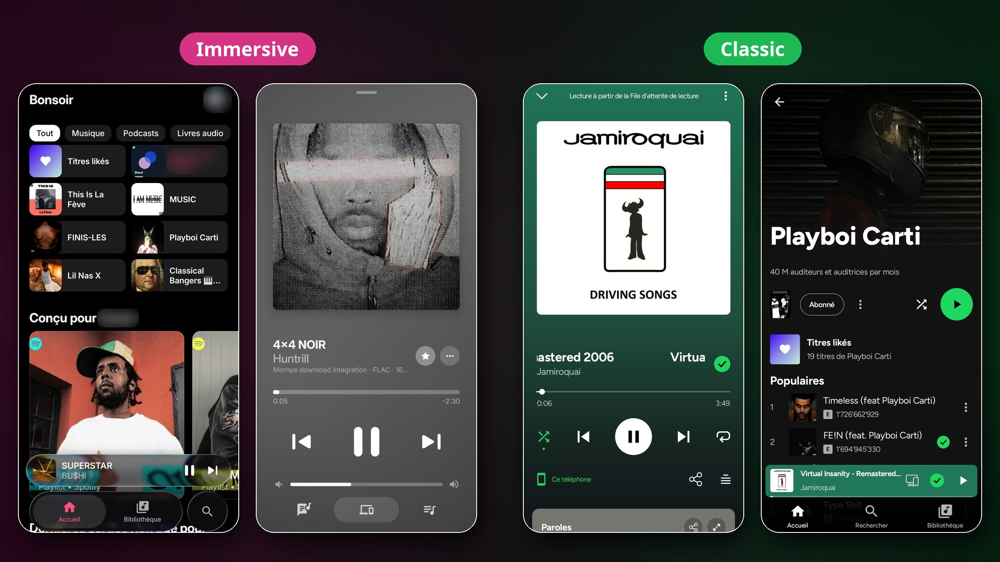
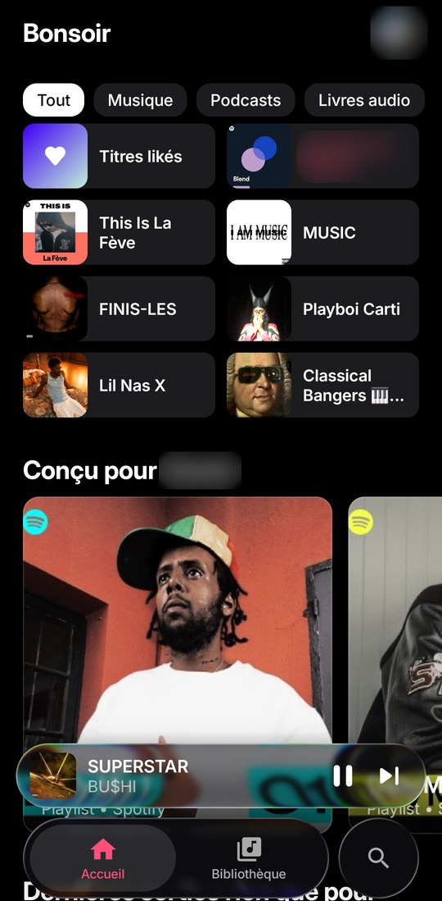
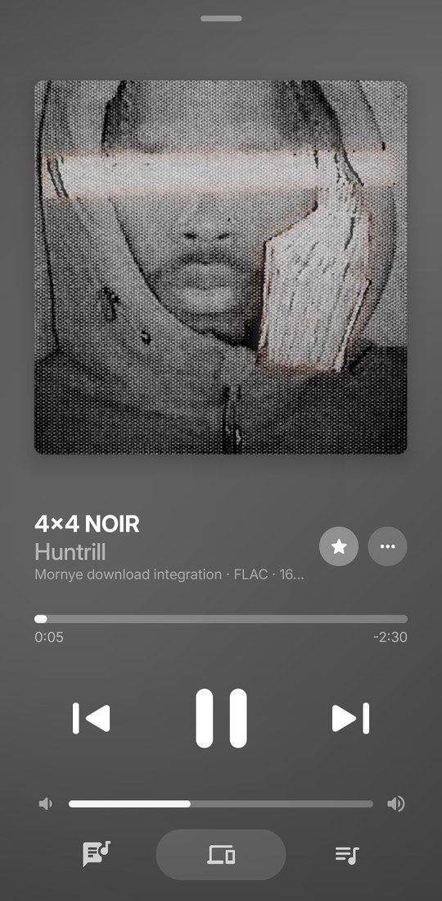

# Orpheon

*Formerly Myspoti. The community chose the new name; version 1.0.0 is the first under it. The icon is a placeholder until the real one is made.*

*Coming from Myspoti? Update it to 2.4.1: it offers to install Orpheon, a new app next to it. Betas are on the [releases page](https://github.com/kota-zo/myspoti/releases).*

[](https://github.com/kota-zo/myspoti/releases/latest)
[](LICENSE)
[](https://discord.gg/jXKnGVFnGS)

**A music player for Android, Android TV and Wear OS, with your Spotify account.** Your own Spotify account, playlists and Wrapped, in a native Android app, with sound and offline downloads through extensions you install.

<p align="center">
  
</p>

<p align="center">
  <a href="https://github.com/kota-zo/myspoti/releases/latest"><b>⬇ Download the latest APK</b></a>
</p>

<p align="center"><sub>The Immersive look comes from <a href="https://github.com/kushagrasinghx/BitChord">BitChord</a>: see <a href="#bitchord">Credits</a>.</sub></p>

<p align="center">
  <a href="https://ko-fi.com/myspoti"></a>
  <a href="https://github.com/sponsors/kota-zo"></a>
</p>

## Why Orpheon

### ⬇️ Offline downloads, through extensions
Orpheon has no download source of its own. Install a **download-source extension** (Settings, Extensions) and you can download a song, an album, a playlist or all your Liked Songs, and listen with no connection: on the plane, in the metro, with no data. The extension decides where the files come from and in which formats (FLAC, M4A or MP3); Orpheon keeps them encrypted on your phone, refuses a file that is not the song's length, and keeps downloaded playlists in step: songs you add on Spotify download by themselves.

### ✨ And everything you expect from Spotify, and more
Your home, search, library, playlists, podcasts, Spotify Connect and Android Auto, plus **word-by-word lyrics** and **song meanings from Genius**.

## What is it?

Orpheon is a Spotify app for Android that you install yourself. You sign in with your usual Spotify account, on Spotify's own login page: Orpheon never sees your password. A free account is enough.

Under the hood, the official Spotify Web Player plays the music, hidden inside the app, with your phone's DRM. Orpheon draws its own screens on top and drives it. Your plays are reported to Spotify exactly as in a browser: they count for the artists, in your history and in your Wrapped.

## Get started

1. Download the APK from the [latest release](https://github.com/kota-zo/myspoti/releases/latest) and open it (Android 10 or later). Android asks once to allow installs from your browser or file manager.
2. Tap **Log in with Spotify** and sign in.
3. Pick the sound quality, allow what you want (notifications, Bluetooth, local files…), and you are in.

New versions are offered inside the app: one tap downloads and installs them.

Each release carries four APKs:
- `Orpheon-<version>-ARMv8.apk`: almost every phone from the last ten years (64-bit). When in doubt, take this one.
- `Orpheon-<version>-ARMv7.apk`: older or entry-level 32-bit phones (an app such as CPU-Z or Device Info shows which one yours is; if ARMv8 refuses to install, take this one).
- `Orpheon-<version>-universal.apk`: both in one, larger.
- `Orpheon-<version>-TV.apk`: Android TV and Google TV (the same app; on a TV it opens its TV screens).

Betas are `Orpheon-Beta-<version>-...`. The in-app update picks the right one by itself.

Orpheon is a new app next to Myspoti 2.4 and earlier (`app.myspoti`, `app.myspoti.stable`): Myspoti's update button opens this page instead of installing it, as Android cannot install one app over the other. Install Orpheon, then uninstall Myspoti when you no longer need it.

Obtainium (add `https://github.com/kota-zo/myspoti`; the stable app and the beta app are two apps):
- **Stable** (`app.orpheon`): leave "Include prereleases" off and set the APK filter to `^Orpheon-[0-9].*-ARMv8\.apk$` (or `-ARMv7`, `-TV`).
- **Beta** (`app.orpheon.beta`): turn "Include prereleases" on and set the APK filter to `^Orpheon-Beta-.*-ARMv8\.apk$` (or `-ARMv7`, `-TV`).
- Betas are named `<next version>-beta.<n>` (`1.0.1-beta.1`, then `1.0.1-beta.2`...), marked prerelease on GitHub, and always newer than the last stable.

## What you get

**Listening**
- Home, search, Browse, New releases, Your Library with folders, artist, album, playlist and profile pages, with Spotify's own content.
- Pick any song: shuffle (Spotify's, or Orpheon's own that plays every song once before any repeats), Smart Shuffle, the queue (drag to reorder), repeat (all, the song for good, the song once), crossfade, sleep timer.
- For extension, downloaded and device songs: a 10-band **equalizer** with presets, playback speed and skip silence; **Stats for nerds** shows the codec, sample rate, bit depth, bitrate and output of what plays.
- Podcasts and audiobooks, with their own player (speed, ±15 s, mark as played).
- Spotify Connect, Jam, Bluetooth with your headphones' name, lock screen, notification, widget and Android Auto.

**Lyrics**
- Synced lyrics, word by word when a source has the timing (or line by line, your choice in Settings), with translation.
- **Song meanings from Genius**: a light bulb for the story of the song, and a long press on an underlined line for its explanation, translated into your language.

**Your playlists**
- Create, edit (name, description, cover), sort, make public, private or collaborative.
- **Add songs** from a Spotify search inside the playlist, with suggestions.
- **Collaborative playlists**: invite friends with a link, see who is in, and who added each song.
- Share any song, album, artist or playlist as a **Spotify Code** (scannable in the Spotify app) or a link.

**Offline**
- With a download-source extension installed: download songs, albums, playlists and Liked Songs, in the formats the extension offers (or re-encoded to small AAC on the phone).
- Downloads are encrypted and stay in Orpheon. Lists you downloaded stay in step with Spotify.
- Your local audio files too.

**Extensions**
- Scripts written by other people, in a sandbox: lyrics from other sources, where a song's audio or download comes from, Home sections, menu entries, tools that use your Spotify account.
- Installing shows what an extension will do (each action with its author's reason, the critical ones marked) and asks for one tick: you install it on your own responsibility. An extension gets every action it lists, or is not installed; an update that asks for more waits for your OK and shows only what changes.
- With an audio-source extension on, every song you play (from a list, search, an artist, Recents, a link or shuffle) is asked there first, and plays on Spotify when it has nothing.
- An extension can bring its own settings to Settings, Playback or Downloads (its quality, per network if it likes): the first source of the order shows its own, and an extension above Spotify replaces Spotify's quality settings there.
- New to extensions? [The user guide](docs/extensions/GUIDE.md): the kinds, installing one, the order of the sources, and what to do when one does not work (Android Auto and Android TV too).
- For authors: [the extensions API](docs/extensions/API.md), and a desktop runner to test without a phone.

**And also**
- Your recap: your top songs, artists and albums, kept on your phone.
- **Live Radio**, off until you turn it on (Settings, Playback): internet radio from the free [Radio Browser](https://www.radio-browser.info) directory, https streams only, favorites kept on your phone. Searches go to Radio Browser, and each station's logo and stream come from that station's own server.
- 69 languages and regional variants, following the phone or picked by hand.
- Data saver, battery saver, AMOLED black, accent colour.

## New since 1.1

Version 2.0 is a new app, rebuilt from the ground up.

- 🚀 **A new engine**: faster screens, quicker skips, and playback that recovers by itself when Spotify's player stumbles.
- 🎧 **Downloads through extensions** instead of built-in YouTube audio, encrypted on your phone.
- 🎤 **Word-by-word lyrics**, from more sources, with **Genius song meanings**.
- 👥 **Collaborative playlists**, an **Add songs** screen, and full playlist editing.
- 🔀 **Smart Shuffle**, a draggable queue, crossfade.
- 🎙️ **Podcasts and audiobooks** are back, with their own player and downloads.
- 📷 **Spotify Codes** to share, and profiles, Recents, Browse and New releases.
- 🌍 **Four new languages**, in-app updates and a diagnostic report you can send in one tap.

Every change is in the [changelog](CHANGELOG.md).

## Screenshots

Two looks, switched in Settings, Display.

**Immersive**

| Home | Player |
|:---:|:---:|
|  |  |

**Classic**

| Home | Player | Artist | Album |
|:---:|:---:|:---:|:---:|
|  |  |  |  |

## Questions

**Is it safe for my account?** Orpheon talks to Spotify the way its web player does, and you sign in on Spotify's own page. Ads play as Spotify sends them, except on a Spotify Connect device you send the music to from the app, where they are muted and their ad hosts refused; blocking ads is against Spotify's Terms of Use (see the disclaimer below).

**"Spotify refused to play this"?** Some new or free accounts get refused by Spotify. Settings → **Export a diagnostic report** and send it on [Discord](https://discord.gg/jXKnGVFnGS) or in an [issue](https://github.com/kota-zo/myspoti/issues): it holds the app's recent log (what Spotify answered) and your phone's model, never your password or your login tokens.

**Do downloads count in my Wrapped?** They always count in Orpheon's own recap. A downloaded song plays only from the phone: it is not played on Spotify and nothing is reported. Streamed songs count as usual.

**What leaves my phone?** Your plays go to Spotify. Lyrics are looked up on lyrics sites, song meanings on Genius, translations on Google Translate, and downloads on the hosts your download-source extension names (shown before you install it). Live Radio, once turned on, searches [Radio Browser](https://www.radio-browser.info) and loads each station's logo and stream from that station's own server. Nothing is sent to the developer.

## Not included

- No DRM circumvention, and no Spotify audio download: offline songs come from the download-source extension you install, and a song it has no file for is marked unavailable. Orpheon ships no download source of its own.
- No ad is ever marked as heard.

## Disclaimer

Blocking ads goes against Spotify's Terms of Use, and Spotify may suspend accounts that do it. Use this app at your own risk. If you can, support artists with Premium or by buying their music.

Not affiliated with or endorsed by Spotify. Spotify is a trademark of Spotify AB.

## Support

Orpheon is free, has no ads and is made in my spare time. If you enjoy it, you can support it on [Ko-fi](https://ko-fi.com/myspoti) or [GitHub Sponsors](https://github.com/sponsors/kota-zo), also from **About** in the app. Nothing is locked behind a donation.

News, help and ideas: the [Discord server](https://discord.gg/jXKnGVFnGS). Bugs and requests: [GitHub issues](https://github.com/kota-zo/myspoti/issues).

## For developers

The Android project is in `base/`, in seven Gradle modules:

- **`:api`** is the contract the UI talks to: plain Kotlin models and interfaces (player, search, catalog, library, playlists, home, podcasts, users, lyrics, devices, Jam).
- **`:api-spotify`** implements it on Spotify's Web Player. Playback stays in the official player, in a hidden WebView (`:host-android`), driven by a small bridge script. Catalog, search and library calls go straight to Spotify's servers. When Spotify ships a new Web Player, the app reads its new operation list by itself.
- **`:host-android`** is that WebView, plus the playback service (media session, notification, Android Auto browsing) and the app's Android-only pieces (logbook, covers).
- **`:host-cdp`** runs the same API on desktop Chrome, so the whole API is tested against the real Web Player without a phone.
- **`:extensions`** is the sandbox third-party scripts run in (manifest, permissions, catalogue), plain JVM: an extension runs the same on a desktop. **`:extensions-cli`** is that desktop runner.
- **`:app`** is the Compose UI, in its Classic and Immersive looks.

More: [`base/api-spotify/README.md`](base/api-spotify/README.md) and [`docs/api`](docs/api).

Requirements: JDK 17+ and the Android SDK (compileSdk 37).

```bash
cd base
./gradlew assembleDebug
./gradlew testDebugUnitTest
```

Live API tests (desktop Chrome with a signed-in Web Player):

```bash
google-chrome --user-data-dir="$HOME/.myspoti-chrome" --remote-debugging-port=9222
./gradlew :host-cdp:test -Pcdp=http://localhost:9222
```

Every push builds and tests on GitHub Actions. A `vX.Y.Z` tag publishes a stable APK in Releases and a `vX.Y.Z-beta.N` tag a beta one (a prerelease, `tools/check_tag.py` checks the number).

## Credits

### BitChord

Orpheon owes a lot to [BitChord](https://github.com/kushagrasinghx/BitChord) by kushagrasinghx and its contributors (GPL-3.0-or-later), in code:
- **The Immersive look** is ported from it: the player and its mesh backdrop, the swept word-by-word lyrics, the queue panel, the glass tab bar, the top bars, the sheets, the motion and the Home, Search, Library, artist, album, playlist, profile and podcast pages.
- **The equalizer** of the songs the app plays itself: its filters and the way a change glides.

Every file taken from BitChord keeps its GPL-3.0-or-later header and names the BitChord file it comes from; the full list is in [`THIRD_PARTY_NOTICES.md`](THIRD_PARTY_NOTICES.md#bitchord--gpl-30-or-later). Thank you, BitChord.

### Others

- UI derived from [Spotui](https://github.com/Spotui/Spotui) / [Metrolist](https://github.com/MetrolistGroup/Metrolist) (GPL-3.0); Spotui also gave the DASH-to-FLAC remux.
- [NewPipeExtractor](https://github.com/TeamNewPipe/NewPipeExtractor) (GPL-3.0): music videos.
- [Reorderable](https://github.com/Calvin-LL/Reorderable) (Apache-2.0): dragging the rows of the queue.
- Lyrics: [LRCLIB](https://lrclib.net), LyricsPlus, lrc.red, Kugou and NetEase; song meanings: [Genius](https://genius.com).
- [Material Icons](https://github.com/google/material-design-icons) (Apache 2.0) and the [Manrope](https://github.com/googlefonts/manrope) font (SIL OFL 1.1, see `base/licenses/`).

Full notices: [`THIRD_PARTY_NOTICES.md`](THIRD_PARTY_NOTICES.md).

## License

GPL-3.0. If you reuse this code, you must credit Orpheon, keep the license notices and
publish your complete source under GPL-3.0. Closed-source or uncredited copies are
violations and will be reported to the hosting platform (DMCA takedown). See also
[`AGENTS.md`](AGENTS.md).
